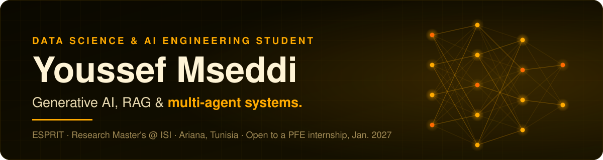

 

**🎯 Seeking a 6-month end-of-studies internship (PFE) in AI / Data Science, starting January 2027.**

## About me

I'm a **Data Science & AI engineering student at [ESPRIT](https://esprit.tn)**, also completing a **Research Master's in Software Engineering at ISI Ariana**. I build AI systems end to end: LLM agents and RAG pipelines, the ML models behind them, and the data and MLOps they run on.

**What I do**

- **Generative AI:** RAG assistants, multi-agent systems with LangGraph and n8n, prompt engineering and LLM fine-tuning (LoRA, QLoRA).
- **Machine learning:** classification, regression, time series, anomaly detection and model benchmarking with Scikit-learn and PyTorch.
- **BI and data engineering:** data warehouses, ETL pipelines and Power BI dashboards.
- **MLOps and delivery:** FastAPI and Streamlit apps, Docker, Airflow, MLflow and Grafana monitoring.

## Tech stack

**AI and data science**

**Data, MLOps and cloud**

**Web and languages**

Also: LangChain, LangGraph, OpenAI, Groq, Cohere, Whisper, FAISS, ChromaDB, Qdrant, Pandas, NumPy, Pydantic, Power BI, Talend, SSIS, SSAS, Spark, Airflow, n8n, MLflow, Power Automate, Streamlit, Quarkus and SAP (ABAP, Fiori, BW).

## Experience

**AI & Automation Intern · Deloitte** · Jul 2026 to Sep 2026 · Tunis
- Multilingual **RAG knowledge assistant** for the IT Audit team, giving junior auditors direct access to training materials and ITGC controls.
- Built with Python, ChromaDB, embedding models, FastAPI, Streamlit and OpenAI, with an admin interface to enrich the knowledge base; internal mailing workflows automated with Power Automate.

**AI Researcher, Autonomous BI Systems · LIMTIC Laboratory** · Apr 2026 to Oct 2026 · Ariana
- Master's thesis *Design and Implementation of an Autonomous Business Financial System*: literature review and benchmark of **13 ML models on 5 financial datasets** (credit, default, fraud, stock market).
- Autonomous BI system: results stored in an **OLAP cube** (Model × Dataset × Metric) and an **orchestrator** that selects the best model for each financial problem by F1-score.

<b>Earlier roles</b>

- **Business Analyst Intern · BH Bank** (Jul 2025): banking operations, credit, management control and trading, with their data flows and decision processes.
- **Full-Stack Developer · Wecraft** (Feb to Aug 2024): CRM modules for pharmaceutical laboratories on a microservices architecture (React, TypeScript, Java Quarkus, PostgreSQL), in an Agile Scrum team.

## Featured projects

<table>
<tr>
<td width="33%" valign="top">
<h3>🧩 BI-Flow</h3>
Multi-agent BI system with explainable AI: a <b>LangGraph orchestrator</b> drives 7 agents from raw data to an explained dashboard (profiler → quality → ETL → semantic → analyst → dashboard → XAI), with a bounded re-cleaning loop and failure routing.  
Python · LangGraph · Multi-agent · XAI · Pytest
</td>
<td width="33%" valign="top">
<h3>🚗 <a href="https://github.com/youssef-mseddi/rentflow-ai">RentFlow AI</a></h3>
Turnkey AI platform for car rental and sales agencies: a <b>voice assistant</b>, an <b>admin assistant</b> and a <b>mailing assistant</b> orchestrated by n8n, with RAG on Qdrant and calculation tools for accurate quotes.  
n8n · Qdrant · Whisper · Cohere · OpenAI · Docker
</td>
<td width="33%" valign="top">
<h3>🏦 Autonomous Financial BI</h3>
Research at LIMTIC: 13 ML models benchmarked on 5 financial datasets, an OLAP cube of F1-scores and an orchestrator that picks the best model for each problem.  
Python · Scikit-learn · CatBoost · LightGBM · PyTorch
</td>
</tr>
</table>

<b>More projects (5)</b>

| Project | What it is | Stack |
|---|---|---|
| **[BI & AI Platform for a Scout Center](https://github.com/youssef-mseddi/Scouts_Center_App)** | Data warehouse, ETL, dashboards, ML prediction, anomaly detection and time-series forecasting. | Power BI, Talend, Airflow, Python, MySQL |
| **[Bike Demand Prediction](https://github.com/youssef-mseddi/Bike-Predictive-App)** | Demand forecasting from weather and time data, KMeans and PCA segmentation, Flask dashboard. | Python, Scikit-learn, Flask |
| **[Medical Anomaly Detection](https://github.com/youssef-mseddi/Medical-Anomaly-Detection-System)** | Disease prediction from symptoms, combining ML and web-ontology reasoning. | Python, ML, OWL |
| **[AI Translator](https://github.com/youssef-mseddi/Translator_App)** | Multilingual LLM translator. | Streamlit, LangChain, Groq |
| **[Facial Emotion Recognition](https://github.com/youssef-mseddi/Emotion-recognition-using-machine-learning)** | Emotion classification on the BioID dataset. | SVM, KNN, Random Forest |

## Education, certifications and languages

**Engineering Degree in Computer Science, ESPRIT** (2025 to present) · **Research Master's in Software Engineering, ISI Ariana** (2024 to 2026) · **Bachelor's in Software Engineering & Information Systems, ISTIC** (2021 to 2024)

**NVIDIA:** Building LLM Applications with Prompt Engineering · Transformer-Based NLP (2026) · **Competitive programming** in C++ (Freeways ISI, TCPC)

Arabic (native) · French (B2) · English (B2) · German (A2.1)

 

**Have an AI or data internship in mind?** [Email me](mailto:youssef.mseddi0@gmail.com) or [connect on LinkedIn](https://www.linkedin.com/in/youssef-mseddi-690078228/).

